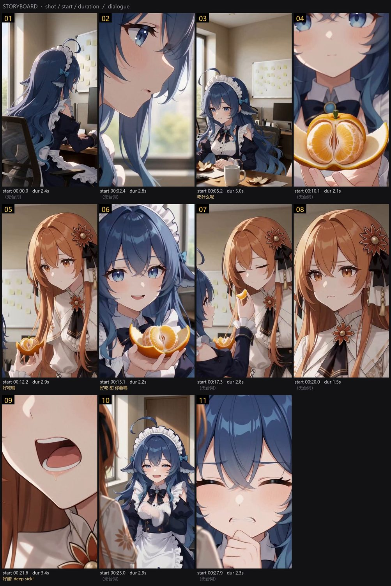

# shot-storyboard

把一条视频压成**一张宫格图**，让只能读文字的 AI 也能看懂镜头结构。

一条 30 秒的片子 → 11 格图 + 一张镜头表。AI 看一眼就知道：几个镜头、每个多长、怎么切、节奏赶不赶。

---

## 为什么需要它

想让 AI 分析一条视频，直接塞整段会很贵：三分钟的片子几十万 token，还动不动被截断。

但其实你不需要它"看视频"，只需要它"知道结构"。

镜头一切换，画面就会突变。把这个突变点抓出来，每个镜头抽一张图，拼成宫格、标上时间码 —— 一张图就够了。

**成本从几十万 token 降到一张图的量级。**

---

## 效果



每格左上角是镜头编号，下方是起始时间码和时长：

```
#01   0.00 →  2.42 (2.42s)
#02   2.42 →  5.17 (2.75s)
#03   5.17 → 10.12 (4.96s)
...
```

时间码连续无缝，说明没有漏检、没有重复。

---

## 安装

需要两样东西：

1. **ffmpeg** —— 必须，且要在 PATH 里
   - Windows：`winget install Gyan.FFmpeg` 或从 [gyan.dev](https://www.gyan.dev/ffmpeg/builds/) 下 essentials 版
   - macOS：`brew install ffmpeg`
   - Linux：`apt install ffmpeg`
2. **Pillow**

```bash
pip install pillow
```

---

## 用法

```bash
python storyboard.py 你的视频.mp4
```

输出两个文件（和视频同目录）：

- `你的视频_storyboard.jpg` —— 宫格图，喂给 AI
- `你的视频_shots.json` —— 镜头表，给程序用

### 常用参数

| 参数 | 默认 | 说明 |
|---|---|---|
| `--threshold` | `0.3` | 场景检测灵敏度。**越低越敏感**（0.2 会把轻微变化也当切换），越高越保守（0.5 只抓大切换） |
| `--cols` | `4` | 宫格列数。镜头多就加宽，镜头少就 3 列更好看 |
| `--max` | `24` | 最多保留几个镜头。超了会自动等间隔抽 |
| `-o` | 视频同目录 | 输出目录 |

例子：

```bash
python storyboard.py 片子.mp4 --threshold 0.4 --cols 5 --max 30 -o ./out
```

---

## 什么时候会翻车

| 情况 | 会怎样 | 怎么办 |
|---|---|---|
| **快切连拍**（一秒好几个镜头） | 可能漏检，合并成一个长镜头 | 降低 `--threshold` 到 0.2 左右 |
| **闪白 / 闪黑转场** | 会多抓出碎片镜头 | 脚本已自动丢掉小于 0.15 秒的碎片 |
| **渐变溶解转场** | 画面变化平滑，可能抓不到 | 这是 scene 检测的天花板，需要换更复杂的算法 |
| **画面本身剧烈运动**（手持晃动、爆炸） | 可能误判成切换 | 提高 `--threshold` 到 0.4~0.5 |
| **一条片子只有 1 个镜头** | 只出一格 | 正常，这时候不适合用这个方法 |

---

## 什么时候别用

- **你就想问一句话**（"这条片子讲了什么"）—— 直接问，别绕这一圈
- **片子不到 10 秒** —— 一格图就完了，没必要
- **你要分析画面细节** —— 宫格图分辨率有限，得用视频理解模型

---

## 原理（四步）

```
1. ffmpeg scene 检测     →  找出画面突变的时间点
2. 每个镜头抽 1 帧        →  不重复也不漏
3. 拼宫格 + 烧时间码      →  让 AI 知道先后顺序
4. 喂给 AI               →  一张图读完整个结构
```

没有时间码的话，AI 只知道"有些画面"，不知道"谁在前谁在后"—— 这是整个方法的关键。

---

## 许可证

MIT
